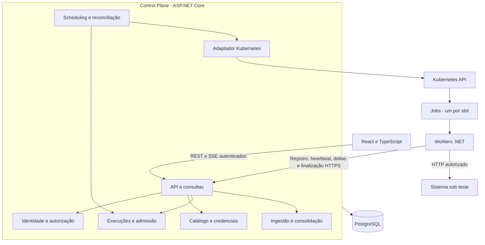

# 02 — Arquitetura do sistema

## Estrutura proposta

Um deploy do Control Plane reúne API REST/SSE e tarefas de fundo. PostgreSQL guarda intenção, estados, identidades, configurações e métricas. Um Job por slot executa um worker com plano imutável. Workers chamam o Control Plane e o destino autorizado; nunca acessam o banco. A escolha de monólito evita uma transação distribuída entre cadastro, quotas e início de execução.



O retorno de métricas, ausente no desenho inicial do produto, é uma fronteira obrigatória. O tráfego de controle usa cliente HTTP e orçamento de recursos separados do tráfego de teste.

## Módulos e propriedade

| Módulo | Responsabilidade exclusiva | Não deve fazer |
|---|---|---|
| Identidade e acesso | Login, sessão, memberships, decisão de acesso | Orquestrar Job |
| Catálogo | Projetos, revisões, credenciais, destinos aprovados | Alterar snapshot em execução |
| Execuções | Máquina de estados, quotas reservadas, plano, motivos de encerramento | Falar diretamente com Kubernetes |
| Reconciliação | Comparar intenção persistida e observações, solicitar efeitos idempotentes | Ser uma segunda máquina de estados |
| Adaptador Kubernetes | Criar/observar/remover recursos rotulados e validar UID | Decidir regras de negócio |
| Métricas | Validar envelopes, deduplicar, consolidar, expor cobertura | Inferir sucesso a partir de HTTP 200 |
| Consultas | Compor projeções paginadas e SSE | Modificar execução |

Scheduling significa admissão e distribuição de slots, não calendário de testes recorrentes. Consulta é uma parte fina da API, não precisa de serviço ou banco próprio. Eventos de auditoria são persistidos junto às mudanças relevantes, sem introduzir event sourcing.

No worker, separar planejamento de chegadas, transporte HTTP, agregação e ciclo de vida; medição de tempo acompanha o transporte, e controle de concorrência acompanha a admissão. Não criar sete microcomponentes com interfaces para cada método. Interfaces só nas fronteiras substituíveis: relógio, transporte de teste, canal de controle e armazenamento/adaptador Kubernetes no servidor. Contratos serializados compartilhados não carregam entidades ORM.

Dependência lógica: API → casos de uso → regras/contratos; adaptadores implementam I/O requerido pelos casos de uso. O motor não conhece ASP.NET, PostgreSQL ou Kubernetes. A CLI local e o host de worker são dois consumidores do mesmo motor.

## Fluxo normal

```mermaid
sequenceDiagram
    actor U as Usuário
    participant CP as Control Plane
    participant DB as PostgreSQL
    participant K as Kubernetes
    participant W as Workers
    participant S as Destino
    U->>CP: Criar execução + Idempotency-Key
    CP->>DB: Snapshot, quota, QUEUED e evento em transação
    CP-->>U: 202 + executionId
    CP->>DB: Claim com lease e versão
    CP->>K: Assegurar Jobs de nomes determinísticos
    K->>W: Iniciar processos
    W->>CP: Registrar tentativa e declarar Ready
    CP->>DB: Persistir plano fixo e T0 futuro
    W->>CP: Confirmar plano e solicitar autorização
    CP->>DB: Todos confirmados; RUNNING + leases
    CP-->>W: Plano, T0 e permissão de geração
    W->>S: Chegadas open-loop da parcela atribuída
    loop Controle e métricas
      W->>CP: Heartbeat / delta imutável
      CP->>DB: Renovar lease / inserir delta e consolidar
      CP-->>U: SSE com snapshot persistido
    end
    W->>CP: Manifesto final e último sequence
    CP->>K: Observar término e limpar recursos
    CP->>DB: Fechar cobertura, resultado e estado terminal
```

Não existe broadcast atômico entre banco e todos os workers. Se apenas alguns recebem a autorização final, o teste é interrompido e marcado parcial. Nunca afirmar início simultâneo perfeito. Detalhes de tempos, fencing e parada estão em [05](05-EXECUTION-LIFECYCLE.md).

## Comunicação e consistência

REST JSON para catálogo, comandos, registro e heartbeat. Deltas usam envelope JSON versionado e histogramas binários em base64 inicialmente, com limite de corpo; o overhead de base64 entra no benchmark de ingestão. API retorna ACK somente após commit. Retry com backoff/jitter é permitido no controle e nas métricas, nunca como política adicional no tráfego gerado.

SSE entrega snapshots globais persistidos, eventos de estado e freshness. Um consumidor lento recebe o snapshot mais recente, sem fila ilimitada; a reconexão reconsulta estado e janelas por REST. Não prometer replay de cada atualização SSE. Uma réplica pode fazer polling das revisões no PostgreSQL a cada segundo e compartilhar esse resultado entre assinantes locais. Não fazer uma consulta por assinante nem exigir afinidade de sessão.

Fila de trabalho é a tabela de execuções, com `next_reconcile_at`, lease do reconciliador e versão. Claims curtos podem usar `FOR UPDATE SKIP LOCKED`; não manter transações abertas enquanto se chama Kubernetes. O comportamento de pular linhas bloqueadas serve a consumidores concorrentes, não a consultas gerais consistentes. [Referência PostgreSQL](https://www.postgresql.org/docs/current/sql-select.html).

## Kubernetes e recursos

Proposta: namespace do Control Plane/banco e namespace de workers. Um Job por slot, `parallelism=1`, `completions=1`, `backoffLimit=0`, `restartPolicy=Never`. Nome determinístico por execution/slot; verificar labels, UID e hash do plano antes de adotar. Jobs podem iniciar processos duplicados, portanto o registro do worker precisa de exclusão no banco; o Job não oferece execução exatamente uma vez. [Referência Jobs](https://kubernetes.io/docs/concepts/workloads/controllers/job/).

`activeDeadlineSeconds` cobre preparação + duração + timeout + flush + margem; não serve como timer preciso de carga. `terminationGracePeriodSeconds` cobre aborto e flush, inicialmente 20 s. TTL de Jobs só após janela para coleta de evidências, inicialmente 1 h. Snapshot de condição, exit code e OOM deve estar no banco antes da limpeza normal; se a evidência se perder, registrar desconhecido.

Hipótese de laboratório por worker: request/limit de 1 CPU e 512 MiB, concorrência inicial 64, corpo limitado a 1 MiB e buffer de leitura de 16 KiB por requisição ativa. Esses números não autorizam uma quantidade de RPS. CPU limitada pode sofrer throttling; memória pode provocar OOM. Coletar ambos e validar envelope no host real. [Semântica dos recursos Kubernetes](https://kubernetes.io/docs/concepts/configuration/manage-resources-containers/).

Helm entregará Deployment/Service do CP, configuração, ServiceAccounts, Roles, quotas e políticas. Templates de Job são construídos a partir de configuração aprovada do servidor, nunca de YAML do usuário. PostgreSQL no Minikube usará PVC para ensaios de reinício; produção exige backup/restauração e estratégia de disponibilidade antes da abertura. Não assumir que um PVC de laboratório substitui backup.

## Escala e falhas

Escalar workers **antes** da execução, com parcelas fixas. Não redistribuir RPS quando um worker falha: isso muda o experimento e pode provocar excesso temporário. Parar a execução e preservar o resultado parcial. RPS global é um orçamento de chegadas, não garantia física de entrega.

Começar com uma réplica de CP, mas sem estado autoritativo em RAM. Para múltiplas réplicas: leases, atualizações condicionais por versão, sessões/chaves compartilhadas, SSE com snapshots do banco. Antes de aumentar réplicas, testar disputa de reconciliação e deduplicação. PostgreSQL único permanece limite e ponto de falha; indisponibilidade suspende novos testes e deixa leases de workers expirarem.

O ingresso de métricas deve ter limites separados de login/API humana, número de requests concorrentes e pool de conexões do banco limitado. Admissão de execução reserva recursos e orçamento de ingestão em transação; não aceitar infinitos Jobs Pending. Sem autoscaler, usuários recebem rejeição ou fila com prazo.

## Matriz das questões técnicas obrigatórias

| Questão | Solução inicial | Alternativa e motivo para adiar | Risco principal | Validação |
|---|---|---|---|---|
| Coordenação | Plano persistido, polling e leases | Broker adiciona operação sem necessidade demonstrada | Partição e ACK perdido | Matar CP em cada etapa, 05 |
| RPS global | Partição determinística dos índices de chegadas | Rate limiter central por request cria gargalo | Jitter e drops | Somar planos e medir início/segundo, 03 |
| Inícios diferentes | Ready, T0 futuro e limite de atraso | Começar ao subir cada Pod distorce perfil | Relógios divergentes | Atrasar um Pod e bloquear barreira |
| Saturação | Drops, lateness, CPU/GC, fila HTTP e concorrência | Inferir por latência apenas é ambíguo | Resultado enganoso | Fixture rápida + CPU reduzida |
| Conexões/sockets | Handler por execução, keep-alive e limites | Cliente por request esgota portas | NAT/TIME_WAIT | Execução prolongada + contador de conexões |
| Memória/concorrência | Limites explícitos e Little como estimativa | Tarefas ilimitadas acumulam trabalho | OOM e fila oculta | Corpos lentos, RSS e in-flight |
| Percentis | Mesclar buckets, consultar rank global | Média de percentis é incorreta | Quantização e dados ausentes | Vetores conhecidos e merges, 03 |
| Histograma | Log fixo versionado, 32 subdivisões por potência de 2 | HDR mais preciso exige pacote validado | Custo de sincronização | Teste de limites/benchmark, ADR-005 |
| Cardinalidade | Um endpoint, enums e arrays fixos | Labels por URL/erro livre crescem sem limite | Dados sensíveis | Payload hostil rejeitado |
| Duplicação de métricas | Chave única e hash + merge no mesmo commit | Exactly-once de transporte é inviável | Retry soma duas vezes | ACK perdido e envelope alterado |
| Reinício do CP | Banco autoritativo e reconciliação | Estado apenas em memória se perde | Efeito antes do commit | Reiniciar entre create Job e ACK |
| Cancelamento | Intenção persistida, token, lease e limpeza | Só deletar Job perde evidência | Parada não confirmada | CP fora, rede partida e SIGTERM |
| CPU/RAM K8s | requests/limits e quotas | Defaults ilimitados afetam cluster | Throttling/OOM | Reduzir limites e observar |
| Destinos autorizados | Prova + aprovação + teto por destino | Declaração unilateral não basta | Abuso de domínio compartilhado | Rejeitar destino sem grant, 07 |
| Credenciais | Cifradas, versionadas, acesso por execução | Secret em YAML/log vaza | Roubo de chave | Redaction/rotação/restauração |
| Redes internas/metadados | Política de conexão e egress restrito | Só validar hostname sofre rebinding | SSRF IPv6/DNS | Suíte adversarial e CNI real |
| Minikube protegido | Fixture limitada e subida progressiva | Começar em 50k RPS invalida ensaio | Host compartilhado | Limiares de parada em 08 |
| Worker/rede/alvo | Ensaios A/B e métricas independentes | Diagnóstico automático não é confiável | Confundimento do mesmo host | Separar máquinas e limitar um recurso por vez |

## Trade-off central

Manter o plano fixo e interromper diante de perdas reduz disponibilidade da execução, mas preserva interpretação dos resultados. A alternativa de continuar silenciosamente seria mais simples para a UI e pior para quem tenta medir capacidade. Nesta proposta, disponibilidade do SaaS, conclusão do protocolo e qualidade da medição são dimensões separadas.
