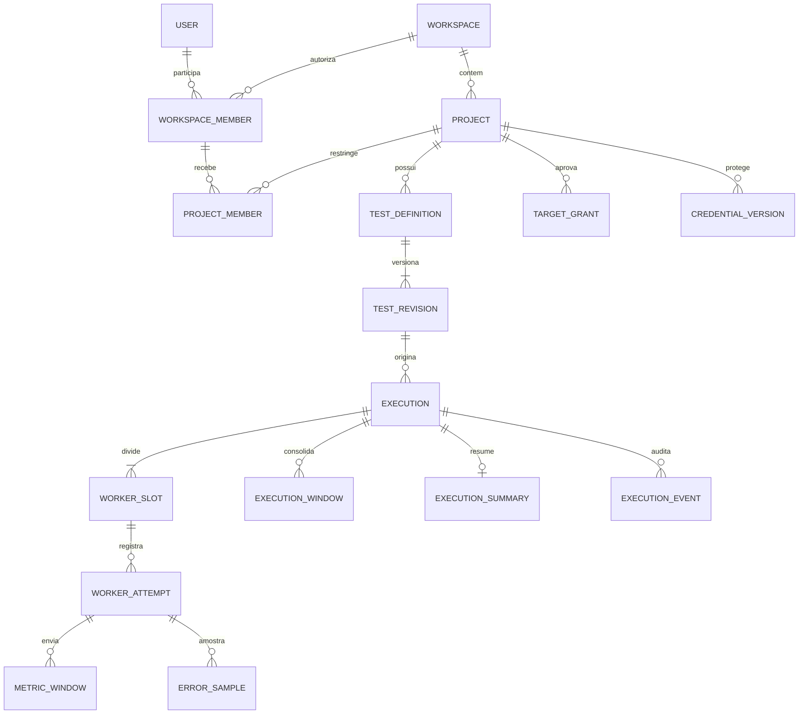

# 04 — Arquitetura de dados

## Modelo e propriedade

PostgreSQL armazena catálogo, coordenação e séries agregadas. Não será usado como fila de cada requisição de carga. UUIDs gerados na aplicação identificam recursos; `timestamptz` representa instantes civis, durações/contadores usam inteiros de 64 bits. Como `bigint` é assinado, contratos e ingestão limitam contadores/somas a 0..Int64.MaxValue, mesmo quando o array binário usa UInt64; ultrapassar é erro explícito. Campos enum são validados e versionados; snapshots públicos pequenos podem ser JSONB com schema validado, mas configuração sensível fica cifrada conforme 07 e histogramas ficam em `bytea` versionado, sem 834 objetos JSON por distribuição.

| Entidade | Campos e regras relevantes |
|---|---|
| Users / sessões / chaves de proteção | Modelo de Identity; hashes de senha, security stamp e sessões revogáveis; sem senha reversível |
| Workspace / Membership | Nome, user_id, papel owner/admin/member/viewer; unique(workspace,user) |
| Project / ProjectMember | workspace_id e acesso explícito; admins do workspace podem administrar projetos |
| TestDefinition / Revision | project_id, revisão crescente, esquema HTTP/perfil, referências de secrets, hash; revisão imutável |
| TargetGrant | workspace/project, hostname exato, scheme/port, prova, aprovação, expiração, quotas e revogação |
| CredentialVersion | project_id, nome lógico, versão, ciphertext, key_version, metadados mínimos e revoked_at |
| Execution | tenant/project, revision_id, snapshot não secreto, desired_action, state, state_version, cause, T0, prazo, quota reservada, owner_lease, next_reconcile_at |
| WorkerSlot | execution_id, slot_index, W, plan_hash, política de recursos; unique(execution,slot) |
| WorkerAttempt | slot_id, attempt_id, pod_uid, job_uid, epoch, token_hash, last_heartbeat, lease_until, final_sequence, exit evidenciado |
| MetricWindow | execution/slot/attempt, sequence, window_index, intervalo relativo, schema/hash, contadores, 2 histogramas, flags |
| ExecutionWindow | execution/window_index, revisão, workers esperados/recebidos, contadores e histogramas consolidados |
| ExecutionSummary | Totais e histogramas finais, flags, cobertura, configuração sanitizada e versões para retenção longa |
| ErrorSample | attempt, sequence e sample_index, categoria, status opcional, fase, timestamp relativo e código sanitizado |
| ExecutionEvent | execution, event_id, actor, estado anterior/novo, reason_code, versão e data; append-only pela aplicação |
| AuditEvent | workspace/project/actor, ação, referência, resultado; inclui alterações fora de execuções |
| ApiIdempotency | workspace, rota, chave, hash do pedido, recurso criado, validade; unique por escopo |

Tenant/project são derivados da sessão e da relação autenticada do worker, nunca aceitos cegamente do body. FKs compostas ou validações transacionais equivalentes impedem relacionar execução e revisão de projetos distintos. Consultas sempre incluem escopo. RLS é defesa possível após testes com pool de conexões; não é necessária para justificar abandonar filtros e testes de isolamento.

## Escrita, idempotência e consolidação

Criação de execução grava snapshot, reserva de quota e evento em uma transação. Chave idempotente com mesmo payload retorna o mesmo recurso; payload diferente retorna conflito. A validade inicial proposta é 24 h, anunciada ao cliente; após expirar, a chave não garante deduplicação. Retry de efeito externo usa nomes de Jobs determinísticos e comparação de UID/plano.

Cada worker emite um delta fechado por janela, com sequence monotonicamente crescente a partir de 0; nunca reenviar “a versão mais atual” de uma janela já enviada. Unique(execution,slot,attempt,sequence) e unique(attempt,window_index) impedem duplicação e troca de sequence para a mesma janela. Hash é calculado sobre representação canônica. Mesma chave/hash é ACK de duplicata; mesma chave/hash diferente é conflito de protocolo e falha de integridade.

Na ingestão, autenticar tentativa e limite de corpo, validar schema, limites/contagens e sequência/janela. Em transação curta: inserir delta; somente se novo, bloquear a linha global daquela janela, somar buckets/contadores, inserir amostras limitadas e incrementar revisão. Commit antes do ACK. Inserções de múltiplas janelas ordenam locks para evitar deadlock; em conflito transacional, retry limitado da transação inteira. `ON CONFLICT` ajuda a reconhecer conflito de chave, mas não substitui conferir conteúdo nem torna efeitos fora da transação atômicos. [Referência INSERT](https://www.postgresql.org/docs/current/sql-insert.html).

Aceitar janelas fora de ordem dentro da execução ativa/finalizando e do limite de atraso; usar sequence para medir lacunas, sem exigir fila ilimitada até chegar uma ausente. Janela global incompleta pode ser exibida, marcada parcial com W esperado e recebido. Consolidação transacional não precisa de “consumed flag” separado que possa divergir. Ao encerrar, conferir manifesto final de cada tentativa: último sequence, quantidade e checksum de contagens. Não fechar `complete` apenas por somar ACKs.

O resultado é selado no estado terminal. Após selagem, ACK para duplicatas já persistidas; novos deltas são rejeitados com resultado explicitamente selado. Não alterar silenciosamente um relatório histórico. Se ocorrer reparo administrativo futuro, deverá gerar uma revisão auditada do resultado.

## Índices e queries

Além das PKs e uniques: `executions(project_id,created_at DESC,id)` para paginação por cursor; índice parcial `executions(next_reconcile_at)` para estados ativos; `worker_attempts(lease_until)` para ativos; `metric_windows(execution_id,window_index,slot_id)`; `execution_windows(execution_id,window_index)` único; `execution_events(execution_id,created_at,event_id)`; `audit_events(workspace_id,created_at)` e índices de retenção por `expires_at`.

Não criar índices GIN sobre todo JSON por antecipação. Consultas principais são detalhe de execução, janelas por intervalo e histórico por projeto. Usar plano de execução e medição de ingestão para rever índices; métricas por worker não precisam de consultas ad hoc globais. Sem partição inicial: retenção em lotes é mais simples. Adotar partições temporais quando deletes, VACUUM ou índices afetarem orçamento medido.

## Crescimento calculado e hipóteses

Unidades binárias: 1 KiB=1.024 bytes, 1 MiB=1.048.576 bytes. Para 10 minutos de geração, D=600 s. Janela Δ=5 s resulta em K=120 janelas, antes do drain. Um endpoint E=1. Contadores são inteiros de tamanho fixo, portanto RPS **não multiplica o número de linhas**.

Tamanho exato dos dois arrays de histogramas: `2 × 834 × 8 = 13.344 bytes`. Array de 500 status HTTP mais `other`, com 64 bits por contador: `501 × 8 = 4.008 bytes`. São 17.352 bytes antes dos outros contadores e metadados. Hipótese para dimensionamento de uma linha lógica: **20 KiB**, incluindo esses arrays e cerca de 3 KiB restantes; não é tamanho físico medido. Armazenar buckets binários densos permite esse cálculo sem depender de compressão. Índices, TOAST, alinhamento, páginas e WAL são adicionais.

Linhas de métricas por execução: `K × (W + 1)` (W séries de workers e uma consolidada). Payload lógico estimado: `120 × (W+1) × 20 KiB = 2,34375 × (W+1) MiB`.

| RPS | Requests planejadas em 600 s | 1 worker | 4 workers | 16 workers | 32 workers |
|---:|---:|---:|---:|---:|---:|
| 1.000 | 600.000 | 4,6875 MiB | 11,71875 MiB | 39,84375 MiB | 77,34375 MiB |
| 15.000 | 9.000.000 | 4,6875 MiB | 11,71875 MiB | 39,84375 MiB | 77,34375 MiB |
| 50.000 | 30.000.000 | 4,6875 MiB | 11,71875 MiB | 39,84375 MiB | 77,34375 MiB |

Essas combinações são análise de armazenamento, **não afirmação de que 1 worker alcança 50.000 RPS** ou de que são necessários 32 workers. A seleção real de W depende de testes do motor.

Custos adicionais calculáveis sob hipóteses explícitas:

- Drain padrão de até 10 s pode adicionar até 2 janelas por série em início alinhado; janela final sem duração não é emitida. Com timeout máximo de 60 s, até 12. Paradas em tempos fracionários exigem arredondar pela posição real da última conclusão.
- Até 100 amostras de erro × 512 bytes = 50 KiB por worker, fora overhead de linhas/índices; em 32 workers, até 1,5625 MiB de conteúdo. Nenhuma cópia das amostras na série global.
- Um resumo final com os dois histogramas e metadados tem orçamento hipotético de 32 KiB por execução. Revisão/snapshot configuracional sem corpo duplicado tem teto de 64 KiB; payload referenciado uma vez na revisão protegida. Históricos mantêm a referência enquanto a execução estiver retida.
- Taxa de novas linhas ≈ `(W+1)/5` por segundo de execução. Com 32 workers: 6,6 linhas/s e 132 KiB/s de conteúdo estimado. Atualizações concorrentes da mesma janela global geram mais WAL que esse payload líquido.
- Banda worker→CP para W=32: `32×20/5=128 KiB/s` antes de envelope/base64/TLS, amostras e retries. Não é banda do tráfego de teste.

Para capacidade de disco, usar cenário de sensibilidade, não “fator garantido”: se tabelas+índices ocuparem 2× o payload lógico, 32 workers requerem cerca de 154,6875 MiB por execução, mais extras. Só `pg_total_relation_size` de ensaio representativo valida o multiplicador. WAL, backups, réplicas, bloat e reserva operacional precisam de orçamento separado; medir bytes de WAL e churn de updates.

Exemplo de retenção, **hipótese** de 100 execuções/dia, W=4: detalhe de 7 dias ocupa `700×11,71875=8.203,125 MiB` (~8,01 GiB) lógicos antes de extras; 30 dias de 3.000 resumos ×32 KiB ≈93,75 MiB. Não confundir com economia medida contra outra ferramenta. Compressão do PostgreSQL pode reduzir arrays esparsos, mas não entra como desconto prometido.

## Retenção e limpeza propostas

| Dados | Prazo inicial | Limpeza |
|---|---|---|
| Janelas worker/globais e amostras de erro | 7 dias após término | Só após resumo selado; deletes pequenos por execução |
| Execução, resumo, eventos de ciclo e revisão referenciada | 30 dias | Limpar filhos em lotes, depois pais sem referências |
| Auditoria de segurança | 90 dias | Registro mínimo sem segredos; exclusão própria |
| Logs stdout em nós | Rotação por tamanho; alvo operacional 24 h | Não são arquivo durável de resultados |
| Idempotency de API | 24 h | Remover expiradas; worker dedup dura enquanto detalhe existir |
| Secrets temporários e grants de worker | Até finalização/expiração | Revogar imediatamente e reconciliar remoção |

Execuções ativas não entram no coletor por simples idade; o reconciliador primeiro resolve timeout e finalização. Cleanup tem lease, orçamento por rodada, retry e métrica de backlog; não faz cascade massivo em horário de ingestão. A política de exclusão solicitada pelo usuário abrange snapshots/payloads/credenciais e documenta atraso em backups. Backups cifrados e teste de restore são gate de produção; prazo de retenção do backup precisa ser definido antes da abertura.

## Validação

Testar concorrência de ingestão e perda de ACK, conflito de hash, lacunas, janela parcial, fechamento fora de ordem, acesso cruzado e crash entre inserção/merge. Medir tamanho físico e WAL com histogramas esparsos/densos, diferentes W e retenção simulada. No Minikube: reiniciar CP e Pod do banco com PVC, provocar indisponibilidade temporária e comprovar ausência de dupla soma. Restore deve ser ensaiado em banco separado antes de apagar qualquer cópia útil.

## Integração prevista de Rate Limiting — M2/M5

Ainda sem implementação de banco ou ingestão. Preservar no snapshot público somente modo, política sem retry e regra de aceitação versionada; referências de credenciais pertencem à configuração protegida de M3. O índice de header do contrato local não substitui uma credential_version persistida.

Janelas futuras carregarão contagens finitas de Retry-After conforme [03](03-LOAD-ENGINE-DESIGN.md), mínimos/máximos normalizados e cobertura de captura. Versionar o envelope antes da primeira persistência; rejeitar schemas incompatíveis. Aplicar deduplicação e merge no mesmo commit também a esses campos. Somar numeradores/denominadores antes de derivar proporção de 429 e somar buckets compatíveis antes dos quantis. Ausência de janela continua desconhecida; uma tentativa perdida não é zero nem será extrapolada. Não armazenar valores brutos de Retry-After, headers de autenticação ou observações por request. Revalidar orçamento de tamanho físico na ficha 013; os 20 KiB acima continuam hipótese.
