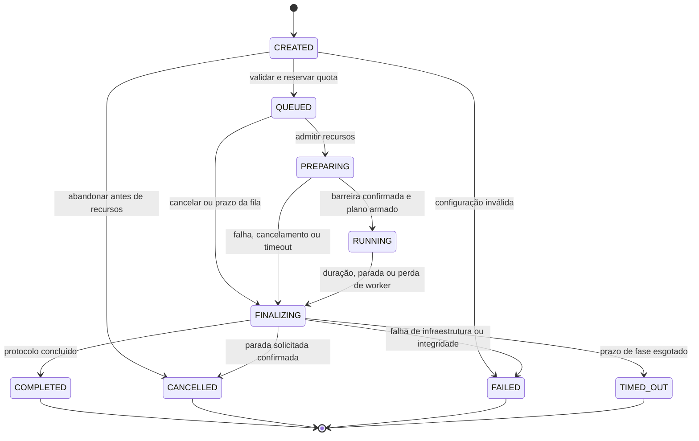

# 05 — Ciclo de vida e coordenação

## Estados, resultado e intenção

O Control Plane é o único escritor do estado autoritativo da execução. Workers reportam observações; Kubernetes informa condições dos processos. A intenção do usuário (`desired_action=run|cancel`) é persistida separadamente. Eventos e `state_version` registram cada transição em transação.

`CREATED` é preparação transacional do pedido, normalmente não visível: o POST pode criar e colocar na fila na mesma transação. Pedidos inválidos retornam 4xx sem obrigatoriedade de criar execução. `RUNNING` significa plano armado para T0, que pode estar alguns segundos no futuro; `actual_first_start_at` e flags indicam se houve tráfego. `FINALIZING` cobre parada, drain, flush e coleta de evidência; não é permitido reiniciar a carga.

Estado terminal, `termination_reason`, `metrics_completeness` e `quality_flags` são campos distintos. HTTP 500 não torna a execução FAILED: é resultado do alvo. Drops de concorrência podem coexistir com COMPLETED e `generator_limited=true`. FAILED pode conter resultados úteis, porém parciais.

## Transições e responsáveis

| Origem → destino | Gatilho e responsável | Efeito persistido |
|---|---|---|
| CREATED → QUEUED | Caso de uso de início, após autorização | Snapshot, plano preliminar, orçamento reservado, prazo da fila |
| QUEUED → PREPARING | Reconciliador obtém capacidade | Slots fixos, plano/hash, nomes de Jobs, prazo de preparação |
| PREPARING → RUNNING | Serviço de execuções confirma barreira | T0, plan_version, autorizações e deadline de geração |
| Estado ativo → FINALIZING | Reconciliador ou caso de uso de cancelamento | Primeiro motivo de parada, instante, revogação de renovação da carga |
| FINALIZING → terminal | Reconciliador verifica dados/processos/prazo | Resumo selado, cobertura, evidência de parada e cleanup pendente |
| CREATED → CANCELLED/FAILED | Caso de uso, nenhum processo iniciado | Motivo e liberação de reserva inexistente/ociosa |

Toda transição exige versão esperada e estado permitido; concorrentes relêem ao perder a atualização. Não usar “última escrita vence”. Motivo inicial é latched; outros motivos viram eventos adicionais. Cancelamento aceito antes da conclusão não se torna COMPLETED. Integridade violada ou parada não confirmada pode elevar o resultado a FAILED. Prazos de execução são distintos de timeouts de requisição: os últimos são dados do teste.

## Preparação, exclusividade e início

1. Reconciliador com lease curto assegura recursos pelo nome determinístico. Adotar somente Job com execution/slot/hash esperados; conflito exige intervenção, nunca apagar Job arbitrário.
2. Pod sobe com identidade de execution/slot, credencial bootstrap limitada e Pod UID. Registro faz compare-and-set para vincular a única tentativa autorizada do slot e seu epoch. Conferir Pod/Job UID com observação confiável do adaptador. Um processo duplicado é recusado antes de receber credenciais do alvo ou permissão de tráfego.
3. Worker valida plano, limites, destino e relógio; recebe segredos só para aquela execução. Declara Ready sem enviar carga. Não fazer “warm-up” HTTP oculto. Aquecimento do runtime/fixture pertence a execução de calibração separada.
4. Todos Ready: CP persiste T0 pelo menos 5 s no futuro e plan_version. Workers confirmam hash/T0 até T0−1 s. Se faltar confirmação, abortar preparação, sem mover T0 indefinidamente e sem worker tardio entrar depois.
5. Todos confirmados: CP arma RUNNING e permite aquisição de lease de tráfego. Cada worker precisa receber essa autorização antes de T0. Sem autorização, não gera carga. Se chegarem tarde mais que 100 ms ou com incerteza acima de 50 ms, recusam início e reportam falha.
6. T0 converte-se em deadline monotônico local. Índices e partição estão em 03. Não modificar W, taxa ou epoch após armar. Não substituir worker durante carga; uma nova tentativa requer nova execução.

Os limiares são hipóteses. Estimar offset com várias trocas de hora/RTT e guardar a amostra de menor RTT, incluindo incerteza e qualidade da sincronização do host. RTT não comprova simetria; se não houver limite confiável de offset, reprovar ou marcar o ensaio como não comparável. Minikube de nó único não valida sincronização entre hosts reais.

## Leases e protocolo de controle

Há dois leases diferentes: lease de **reconciliação** organiza escritores do CP; lease de **tráfego** limita quanto tempo um worker continua sem autorização. Ambos são persistidos. A duração proposta do de reconciliação é 15 s, renovação em 5 s; perder lease impede novos efeitos e exige revalidar versão antes de confirmar efeitos externos.

Heartbeat a cada 2 s retorna ação desejada, plan_version/epoch, hora do servidor e permissão restante, limitada a 10 s, ao fim do plano e à validade de grant/credenciais. Renovar só após transação no banco confirmar execução ativa, tentativa correta e destino/credenciais válidos e não revogados. Na ausência do banco, CP não emite autorização baseada no cache.

O worker converte validade para prazo monotônico conservador, descontando trânsito/incerteza. Resposta atrasada de heartbeat não pode estender um lease antigo: usar request sequence, instante monotônico do envio e rejeitar resposta superada. Ao expirar, parar envios e cancelar operações, registrar `control_lease_expired`, tentar flush e sair. Lease não é garantia física de parada num SO congelado; o worker verifica novamente a validade antes de admitir qualquer chamada após retomar.

| Endpoint lógico | Entrada | Resultado |
|---|---|---|
| POST /executions | revision, perfil autorizado, Idempotency-Key | 202, executionId, state_version |
| POST /executions/{id}/cancel | Sessão autorizada; motivo opcional sanitizado | 202 com intenção ou 200 se já terminal |
| POST /internal/workers/register | Bootstrap, slot, pod_uid, hash | Tentativa vinculada, plano, token limitado |
| POST /internal/workers/{attempt}/ready | Hash, versão, diagnóstico de relógio | Ready persistido ou recusa |
| POST /internal/workers/{attempt}/heartbeat | Sequence, epoch, confirmação do plano, estado local | Ação, autorização temporal e revisão |
| POST /internal/workers/{attempt}/windows | Janela fechada, sequence, hash, schema | ACK após commit, duplicate ou conflito |
| POST /internal/workers/{attempt}/finish | Manifesto final, razão, último sequence, contagens | ACK persistido; pode indicar lacunas |
| GET /executions/{id}/events | Cookie, cursor de snapshot opcional | SSE de estado e métricas persistidas |

Token worker tem escopo apenas nesses recursos da própria tentativa e prazo que permite flush. Autorização de ingestão é separada de autorização para gerar carga: FINALIZING revoga a segunda e mantém a primeira até selagem. Corpo limitado a 256 KiB; um POST transporta uma janela, com os limites de amostra de 06. Retries idênticos com jitter e prazo respeitam o buffer limitado. Os caminhos são contratos propostos, não endpoints já existentes.

## Cancelamento e finalização

Cancelamento grava intenção e transição para FINALIZING no mesmo commit, impedindo novas leases. Workers recebem stop pelo próximo polling e cancelam I/O. Se heartbeat falhar, expiração local faz a parada. Reconciliador dá a janela cooperativa e depois solicita remoção de Jobs/Pods daquela execução. Uma solicitação de delete não comprova morte do processo numa partição de nó.

Fim natural permite drain por até timeout da requisição e flush de 10 s. Prazo do CP para finalizar é timeout +20 s depois do fim da geração/parada. O Kubernetes recebe um deadline externo com margem; é último recurso de contenção, não fonte da medição temporal.

COMPLETED exige todos os slots com manifesto e janelas contíguas válidas, nenhum motivo de infraestrutura fatal e parada dos processos evidenciada. CANCELLED exige pedido aceito e parada confirmada; métricas podem ser parciais. Se prazo acabar sem confirmação de parada, selar FAILED com `stop_unconfirmed`, `metrics_partial` e alerta operacional. TIMED_OUT indica prazo de fila/preparação/execução estourado quando há evidência suficiente para classificá-lo, não uma resposta HTTP lenta.

Estado terminal é imutável, mas `cleanup_pending` e `stop_verified_at` continuam reconciliáveis e auditáveis. **Não liberar reserva de recursos de processos não confirmados como encerrados**, nem criar substitutos; bloquear novas execuções no escopo afetado até evidência ou intervenção. Isso evita tratar um timeout administrativo como prova de que o tráfego acabou.

## Recuperação e conflitos

| Falha injetada | Comportamento esperado |
|---|---|
| CP cai depois de gravar QUEUED | Outro ciclo lê intenção e continua |
| Job criado, CP cai antes de gravar UID | Read por nome/labels/hash identifica mesmo recurso |
| CP cai antes de T0 | Retomada só mantém plano se prazos e confirmações continuam válidos; senão finaliza |
| CP fica fora além do lease | Worker para; CP depois sela execução parcial; nunca retoma a mesma carga |
| ACK de métrica se perde | Worker repete envelope; dedup impede soma dupla |
| Pod morre/OOM | Slot perdido, execução finaliza FAILED; nenhuma reposição de RPS |
| Heartbeat presente, métricas ausentes | Cobertura insuficiente e backpressure; heartbeat não prova integridade das métricas |
| Banco indisponível | Bloquear admissão/renovação; workers expiram |
| Dois reconciliadores | Claims, versionamento e recursos determinísticos convergem sem duas execuções |
| Job completa sem manifesto | Não assumir métrica completa; investigar exit/snapshot e selar parcial |
| Cancelar concorre com fim | Ordem de commit define intenção aceita; estado terminal não reabre |

No Minikube, executar os cenários antes de permitir múltiplos workers. Incluir SIGKILL (sem flush), SIGTERM, API Kubernetes indisponível, duplicata de registro e reboot de CP. Partição de nó e skew entre máquinas exigem laboratório adicional; a validação local não os comprova.

Um lease de reconciliador não oferece fencing atômico sobre chamadas Kubernetes em trânsito. Um escritor antigo pode criar um Job depois de um cancelamento; o registro/autorização no banco recusa qualquer carga, e uma varredura periódica por labels encontra recursos órfãos inclusive de execuções terminais. Essa varredura compara UID e ownership, mantém cleanup observável e não depende apenas da flag gravada antes da chamada externa.
