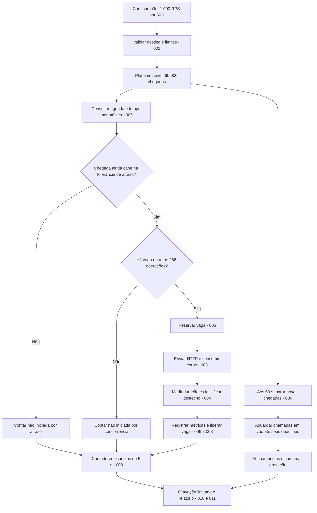

# Entendendo o Load Engine na prática

Imagine que você quer testar uma API com **1.000 requisições por segundo durante 60 segundos**. A pergunta é: “quando eu imponho esse ritmo de chegadas, quantas chamadas consigo iniciar, como elas terminam e quanto demoram?”.

No primeiro marco, essa API será uma fixture: uma pequena aplicação local cujo comportamento controlamos, por exemplo `http://127.0.0.1:5000/produtos`. Ela nos permite testar o próprio motor antes de confiar nele para avaliar outra aplicação.

O plano contém **60.000 chegadas**: `1.000 × 60`. Isso não significa criar 60.000 tarefas de uma vez, manter 1.000 chamadas simultâneas ou receber 60.000 respostas bem-sucedidas. Significa planejar quando cada chamada deveria começar e depois prestar contas do que aconteceu.

Para acompanhar a explicação, considere HTTP/1.1, timeout de 10 segundos e limite explícito de 256 chamadas simultâneas. Esse limite é uma configuração do exemplo; o default documentado continua sendo 64. Não há promessa de que uma máquina específica sustente esse teste: a calibração começa com taxas menores.

Este guia explica o [desenho existente do motor](03-LOAD-ENGINE-DESIGN.md) e as [12 fichas do primeiro marco](implementation-cards/README.md). Não muda contratos, limites ou arquitetura. Todos os resultados numéricos de execução abaixo são exemplos didáticos, não benchmarks realizados.

## O caminho de uma chamada dentro do motor



A agenda continua avançando enquanto chamadas anteriores esperam pela rede. Não precisa esperar uma resposta para considerar a próxima chegada. Uma chamada não iniciada entra nos contadores, mas não produz uma latência HTTP: ela nunca chegou a ser enviada pelo motor.

“Registrar resultados” também não significa salvar uma linha por chamada. A observação atualiza contadores e distribuições em memória; os dados individuais são descartados, salvo poucas amostras sanitizadas de erro.

## Configuração: decidir o experimento antes de começar

Antes de abrir sockets, o motor confere destino permitido, método, headers, tamanho do payload, RPS, duração, concorrência e timeout. A configuração válida vira um plano imutável: o que está sendo medido não pode mudar silenciosamente no meio do teste.

Por exemplo, timeout de 10 segundos significa “vou observar cada chamada por até esse prazo”, incluindo conexão, headers e leitura do corpo. Não significa “a API deveria responder em 10 segundos”; o limite de lentidão aceitável é outra pergunta.

O problema resolvido é evitar experimentos inválidos ou perigosos. Sem essa etapa, um valor digitado errado poderia gerar carga excessiva, atingir outro destino ou criar uma execução impossível de interpretar. No marco local, o destino precisa continuar sendo loopback; editar a URL não habilita testes remotos.

Essa responsabilidade está na [FICHA-001](implementation-cards/FICHA-001-CONTRACTS.md). A API controlada que usaremos para conferir os resultados é a [FICHA-002](implementation-cards/FICHA-002-HTTP-FIXTURE.md).

## Open-loop: a agenda não espera a API responder

A 1.000 RPS, o intervalo ideal entre chegadas é de 1 milissegundo. A agenda definida no projeto começa em 0,5 ms, depois 1,5 ms, 2,5 ms e assim por diante, até 59.999,5 ms. Essa meia distância inicial evita agendar uma chamada exatamente na fronteira de encerramento.

```text
Tempo planejado:     0,5 ms       1,5 ms       2,5 ms       3,5 ms
Chegada:                A            B            C            D
                       |            |            |            |
Resposta de A:         +-------------------------------------> depois

B, C e D não dependem da resposta de A para entrar na agenda.
```

Esse é o modelo **open-loop**: a demanda é definida fora do ciclo de resposta. Se a API fica lenta, a agenda continua pedindo 1.000 novas chamadas por segundo. O limite de concorrência pode impedir parte delas de começar, mas essa perda fica visível.

Compare com 100 clientes que sempre esperam a resposta para enviar a próxima chamada. Com duração média de 100 ms, poderiam sustentar aproximadamente 1.000 RPS. Se a duração sobe para 500 ms, passariam a aproximadamente 200 RPS. É uma aproximação que desconsidera outros custos, mas mostra o efeito: a demanda diminui justamente quando a API piora.

O problema resolvido pelo open-loop é manter a pergunta do experimento: “como a aplicação se comporta sob a taxa solicitada?”. Sem ele, poderíamos apresentar um teste configurado para 1.000 RPS que passou grande parte do tempo enviando muito menos, sem explicar a mudança.

Você pode encontrar o termo *coordinated omission* nesse contexto: observar menos chamadas durante períodos lentos pode fazer o relatório parecer melhor do que a demanda pretendida justificaria. Nosso motor mantém a agenda e mostra atrasos e chamadas não iniciadas. Ele não inventa latências para chamadas que nunca fez.

Esse comportamento pertence à [FICHA-005](implementation-cards/FICHA-005-ARRIVAL-SCHEDULER.md).

## Rate limiting: controlar quando iniciar, sem rajadas de compensação

Aqui, *rate limiting* é o controle do ritmo de início das chamadas. A agenda dá a cada chegada um horário. O loop do motor consulta essa agenda e tenta admitir apenas o que corresponde ao momento atual.

Isso é diferente de disparar 1.000 chamadas juntas no começo de cada segundo. Os dois métodos podem produzir o mesmo total em um minuto, mas a rajada coloca pressão diferente sobre filas e conexões da API.

O motor também não criará um timer por chamada. A proposta usa um loop com despertares de aproximadamente 1 ms. O sistema operacional pode acordá-lo depois do esperado; esse valor não é garantia de precisão. Há tolerância inicial de atraso de 5 ms e um teto de admissões por despertar. Para 1.000 RPS em um worker, o teto definido no desenho é 2.

Suponha que o processo fique 100 ms sem executar por uma pausa ou falta de CPU. Aproximadamente 100 chegadas vencem nesse intervalo. Ao voltar, ele não dispara todas juntas para “pagar a dívida”. Descarta as que já não cabem na tolerância ou no teto daquele despertar e conta `not_started.scheduler_late`.

O problema resolvido é preservar o perfil e revelar a incapacidade do gerador. Sem esse controle, uma pausa produziria um buraco seguido de rajada; uma média de 1.000 RPS poderia esconder ambos. Por isso verificaremos distribuição temporal dos inícios, além do total final.

Continua sendo a [FICHA-005](implementation-cards/FICHA-005-ARRIVAL-SCHEDULER.md), validada em execução real pela [FICHA-012](implementation-cards/FICHA-012-ENGINE-VALIDATION.md). Isso não é o middleware de rate limiting da API testada nem uma decisão de adicionar outra biblioteca.

## Concorrência: quantas chamadas podem ocupar recursos ao mesmo tempo

RPS e concorrência respondem a perguntas diferentes:

| Medida | Pergunta | No exemplo |
|---|---|---|
| Taxa de chegada | Quantas chamadas deveriam começar por segundo? | 1.000 |
| Concorrência | Quantas podem estar em andamento simultaneamente? | No máximo 256 |
| Duração da chamada | Por quanto tempo uma chamada ocupa sua vaga? | Depende da resposta ou do desfecho |

Uma estimativa útil é `concorrência média ≈ taxa × duração média em segundos`. Com 1.000 RPS e 100 ms, seriam aproximadamente 100 chamadas em andamento. Com 500 ms, seriam aproximadamente 500. Essa conta ajuda a perceber um limite; não substitui benchmark nem reserva margem para picos e caudas lentas.

No segundo cenário, C=256 não basta para manter aquela demanda de forma estável. Quando uma chegada encontra todas as vagas ocupadas, ela vira `not_started.concurrency_limit`. O motor não espera uma vaga nem cria uma fila de pedidos para enviar depois.

O problema resolvido é limitar memória, tarefas e conexões sem esconder a demanda que faltou atender. Sem limite, a quantidade de operações poderia crescer até esgotar recursos. Com uma fila ilimitada esperando vaga, teríamos crescimento de memória e envios fora do horário que queríamos testar.

Em .NET, várias operações HTTP podem estar aguardando I/O com `async/await`; isso não exige uma thread exclusiva para cada uma. Ainda assim, cada operação ocupa recursos. A vaga precisa ser liberada em todos os caminhos, inclusive timeout, erro e cancelamento. As tarefas concluídas não ficam acumuladas numa lista até o fim dos 60 segundos.

Um limite cheio é evidência de que o gerador não conseguiu admitir toda a demanda **naquelas condições**. A causa inicial pode ser a API mais lenta, rede lenta ou configuração insuficiente de C. Não significa automaticamente “CPU do worker saturada”.

Essa integração entre agenda, transporte e vagas está na [FICHA-006](implementation-cards/FICHA-006-BOUNDED-CONCURRENCY.md).

## HTTP: enviar é só uma parte do trabalho

Depois de obter uma vaga, o motor usa o cliente HTTP da execução. Ele reutiliza `HttpClient` e o pool do `SocketsHttpHandler`; cria request e response próprios de cada operação. Isso evita reconstruir pools a cada chamada e ajuda a controlar o uso de conexões.

Quando os headers chegam, a operação ainda pode estar longe de terminar. Imagine um HTTP 200 cujos primeiros headers chegam em 20 ms, mas o corpo leva mais 2 segundos. Se medíssemos apenas os headers, apresentaríamos uma duração muito menor que o tempo necessário para consumir a resposta.

O motor lê o corpo em streaming até o fim, usando buffer de 16 KiB por operação ativa, respeitando o teto de resposta. Não precisa guardar o corpo inteiro nem convertê-lo em string. Com 256 buffers ativos, só esses buffers representam 4 MiB; o processo também consome memória com runtime, objetos HTTP, TLS e métricas.

O problema resolvido pelo streaming é consumir e medir respostas sem deixar a memória crescer com o tamanho acumulado dos corpos. Sem ele, respostas grandes sob alta concorrência poderiam tornar o gerador o principal gargalo. Sem reuso e descarte correto, sockets e recursos poderiam se esgotar durante o teste.

HTTP 500 é uma resposta a contabilizar. Se seu corpo chegou completo, ela pertence a `http_completed`, mas não a `http_success` pela regra padrão 200–299. Não fazemos retry adicional para tentar transformá-la em sucesso: isso alteraria a carga. Redirects também não são seguidos automaticamente.

`started` significa que a operação foi admitida para chamar o transporte. Não prova que o servidor recebeu a requisição. DNS, conexão ou rede podem falhar; por isso a fixture tem contagem independente de recebimentos.

Essas decisões estão na [FICHA-003](implementation-cards/FICHA-003-HTTP-TRANSPORT.md), apoiada pela fixture da [002](implementation-cards/FICHA-002-HTTP-FIXTURE.md).

## Tempo monotônico: usar um cronômetro para medir duração

O relógio do calendário responde “que horas são?”. Ele pode ser corrigido enquanto o teste roda. Um cronômetro responde “quanto tempo passou?”, que é o que precisamos para agendar e medir.

Se uma chamada começa às 12:00:00 e o relógio civil é adiantado em 2 segundos antes da resposta, subtrair horários civis pode adicionar um atraso inexistente. Se o relógio voltar, a duração pode até ficar negativa.

O motor usa tempo monotônico, por meio de `Stopwatch`, para intervalos. UTC continua útil para logs e, nas fases distribuídas, coordenação entre máquinas. Um timestamp monotônico de uma máquina não é comparável diretamente ao de outra.

Veja uma chamada ilustrativa:

| Marco | Tempo relativo | O que significa |
|---|---:|---|
| `due` | 20,5 ms | Era o horário planejado |
| `start` | 22,0 ms | Operação admitida, prestes a chamar o transporte |
| `headers` | 62,0 ms | Headers recebidos |
| `end` | 102,0 ms | Corpo consumido integralmente |

O atraso de início é `22 − 20,5 = 1,5 ms`: atraso do gerador. A duração HTTP observada é `102 − 22 = 80 ms`. Ela pode incluir fila do handler, conexão e rede, além do processamento do alvo. Não devemos chamá-la de “80 ms de processamento da API”.

O timeout de 10 segundos cobre envio e leitura. Na estratégia de leitura escolhida, receber os headers não elimina a necessidade de continuar aplicando o deadline ao corpo. Quando esse prazo vence, sabemos por quanto tempo o cliente observou a chamada; não sabemos quando o servidor terminaria de responder.

O problema resolvido é medir intervalos e encerrar operações corretamente. Sem tempo monotônico, ajustes de relógio corromperiam agenda e latência; sem deadline de corpo, uma resposta que para de enviar bytes poderia reter a vaga indefinidamente.

Medição e deadline estão na [FICHA-004](implementation-cards/FICHA-004-TIMING-DEADLINES.md). O scheduler da [005](implementation-cards/FICHA-005-ARRIVAL-SCHEDULER.md) usa o mesmo princípio de tempo.

## Histogramas: guardar a distribuição sem guardar cada chamada

Ao final de 60.000 chamadas, queremos saber se quase todas foram rápidas e algumas muito lentas. Guardar apenas a média perde essa informação; guardar todos os resultados faz memória e armazenamento crescerem com a quantidade de requisições.

Um histograma funciona como caixas de duração. Cada observação incrementa o contador da caixa correspondente. A tabela abaixo usa faixas largas apenas para ensinar; **não é o formato escolhido para o motor**.

| Caixa didática | Respostas na caixa | Acumulado |
|---|---:|---:|
| Até 100 ms | 900 | 900 |
| Acima de 100 até 200 ms | 50 | 950 |
| Acima de 200 até 500 ms | 40 | 990 |
| Acima de 500 até 1.000 ms | 10 | 1.000 |

Ao receber uma nova duração de 150 ms, incrementamos a segunda caixa. Não precisamos guardar “a chamada número 472 demorou 150 ms”. Essa economia significa que depois não conseguiremos reconstruir cada requisição individual.

O formato real, `log2-32-v1`, usa faixas que crescem gradualmente, com 32 subdivisões a cada duplicação de duração. Tem 834 contadores por histograma, incluindo overflow. Cada histograma ocupa 6.672 bytes em contadores, independentemente de representar mil ou milhões de observações dentro dos limites do contrato.

As faixas menores nas durações baixas e maiores nas altas preservam uma precisão proporcional. Ao retornar o limite superior da faixa, aceitamos aproximação de cerca de 2,19% acima de 1 µs, mais o arredondamento de até 1 ns. Abaixo disso, a resolução é de até 1 µs. Acima da última faixa, o resultado é overflow, não um número exato inventado.

O problema resolvido é representar a distribuição com memória fixa. Sem histograma ou estrutura equivalente, precisaríamos escolher entre reter amostras individuais ou perder a informação sobre a parte lenta das respostas.

Implementaremos esse componente na [FICHA-007](implementation-cards/FICHA-007-HISTOGRAM.md).

## P95 e P99: olhar para a parte lenta das respostas

Imagine ordenar 1.000 durações da menor para a maior. O P95 corresponde à posição 950; o P99, à posição 990. São limites que ajudam a responder “quanto tempo levou a maior parte das respostas, incluindo uma parte relevante das lentas?”.

Na tabela didática anterior, a contagem acumulada chega a 950 na caixa de até 200 ms e a 990 na de até 500 ms. Portanto, reportaríamos P95 aproximado de 200 ms e P99 aproximado de 500 ms. O histograma sabe a faixa, não a posição exata de cada duração dentro dela.

Dizer “P95 de aproximadamente 200 ms” significa que pelo menos 95% das observações daquela população ficaram até o limite reportado. Não significa que 95% demoraram exatamente 200 ms, nem que nenhuma passou de 200 ms. P99 também não é a maior duração: existe uma parte da distribuição além dele.

Uma média pode esconder a cauda. Se 990 chamadas levam 10 ms e 10 levam 5 segundos, a média é 59,9 ms. Pelo cálculo de posição adotado, até o P99 desse conjunto é 10 ms: as dez mais lentas vêm depois da posição 990. Por isso P99 não substitui contagem de erros, máximo e análise do restante da distribuição.

O problema resolvido pelos percentis é tornar visível uma parte da experiência que a média esconde. Sem eles, poucos segundos de espera em uma parcela dos pedidos poderiam desaparecer dentro de um número aparentemente bom. Com poucas observações, porém, percentis altos ficam muito sensíveis a poucos valores; sempre mostramos também N, a quantidade de observações.

### De quais chamadas estamos falando?

O motor mantém dois histogramas:

| Histograma | Quem entra | Interpretação |
|---|---|---|
| `http_completed_duration` | Respostas com corpo completo, inclusive 4xx/5xx | Duração das respostas integralmente observadas |
| `terminal_duration` | Operações que terminaram, inclusive timeout, cancelamento e erro | Tempo observado até o desfecho da operação |

P50/P95/P99 principais vêm do primeiro. Imagine 100 respostas completas rápidas e 900 timeouts. O P99 das 100 respostas pode ser excelente; o teste tem 90% de timeouts. O resumo precisa mostrar as duas coisas juntas. Um timeout de 10 segundos não pode virar uma “resposta completa de 10 segundos”.

Sem respostas completas, P95/P99 dessa população são `null`, ou “sem dados”. Zero milissegundos diria outra coisa: que houve respostas instantâneas.

### Como combinar janelas ou workers?

Somamos as contagens de caixas compatíveis e calculamos o percentil novamente. Não fazemos média de P95/P99. Um worker com 9.900 respostas rápidas deve ter peso diferente de outro com apenas 100 respostas lentas.

Isso vale também para combinar as janelas de um único processo. O cálculo está na [FICHA-007](implementation-cards/FICHA-007-HISTOGRAM.md); a integração das populações e janelas está na [008](implementation-cards/FICHA-008-METRIC-WINDOWS.md).

## Janelas de métricas: acompanhar o minuto sem perder as contas

O motor fecha uma janela a cada 5 segundos. Em 60 segundos de geração, temos 12 intervalos desse tamanho; podem existir janelas adicionais enquanto as chamadas restantes terminam.

Cada janela reúne contadores, status, histogramas e indicadores de qualidade. Quando fecha, torna-se imutável. Uma pequena seção protegida sincroniza incrementos e troca do acumulador; gravação de arquivo, logging e envio de rede ficam fora dela.

Uma chamada pode iniciar em 4,9 s e terminar em 5,1 s. Seu início entra numa janela; sua conclusão e duração entram na seguinte. Por isso `iniciadas = concluídas` não precisa valer em cada janela. No total final, com todos os dados, cada iniciada deve ser explicada por um desfecho.

No desenho existente, a atribuição à janela usa o instante de registro do evento no acumulador. A duração HTTP usa os marcos próximos ao I/O. Se a disputa pelo lock atrasar o registro para a próxima janela, não reabrimos a anterior nem somamos essa espera à duração HTTP; medimos o atraso do registro separadamente.

“20 chamadas em voo” é um retrato, chamado *gauge*. Não se soma esse valor de todas as janelas para descobrir um total. Já “20 timeouts nesta janela” é um contador de eventos e pode ser somado às demais janelas.

O problema resolvido é acompanhar evolução com memória limitada e contagens coerentes. Sem janelas, um resumo único esconderia quando houve piora; sem regras de fechamento e população, concorrência e viradas de intervalo poderiam perder ou duplicar observações.

Essa responsabilidade está na [FICHA-008](implementation-cards/FICHA-008-METRIC-WINDOWS.md). Uma janela ausente é falta de informação; uma janela vazia emitida é evidência de que naquele intervalo os contadores foram zero.

## Backpressure: quando o próximo componente não consegue acompanhar

Imagine que o motor gera métricas normalmente, mas o arquivo de saída fica lento. Nas fases futuras, o mesmo pode acontecer quando o Control Plane demora a receber as janelas. O componente que produz dados está mais rápido que aquele que os consome.

*Backpressure* é fazer essa limitação aparecer para quem está produzindo. Em vez de continuar acumulando objetos sem limite, o consumidor sinaliza que já não cabe mais trabalho.

No nosso motor, existem duas respostas diferentes à pressão:

| Onde falta capacidade | Resposta definida | Por quê |
|---|---|---|
| Operações HTTP: todas as vagas estão ocupadas | Contar a chegada como não iniciada; a agenda continua | Esperar mudaria o horário da carga |
| Saída de métricas: buffer não comporta a próxima janela | Parar novas chegadas e declarar resultado parcial | Continuar sem evidência comprometeria o resultado |

O buffer de métricas aceita até 6 janelas e até 256 KiB, respeitando o limite que for atingido primeiro. Não significa que “sempre temos 30 segundos de folga”: tamanho, ocupação e outras condições também importam. No SaaS futuro, perda do lease de controle pode interromper antes disso.

Sem backpressure, uma saída lenta acabaria consumindo toda a memória. Descartar métricas silenciosamente também seria ruim: o relatório poderia parecer completo mesmo faltando justamente o período problemático.

No marco local, o consumidor é a saída do host/relatório; não precisamos implementar comunicação remota para testar esse comportamento. O buffer aparece na [FICHA-008](implementation-cards/FICHA-008-METRIC-WINDOWS.md), a reação de parada na [009](implementation-cards/FICHA-009-LOCAL-LIFECYCLE.md), e a gravação na [011](implementation-cards/FICHA-011-CLI-REPORT.md).

## Encerrar: aos 60 segundos termina a geração, não necessariamente tudo

No fim natural do plano, o motor para de iniciar chamadas e entra em *drain*: espera que as operações já em voo terminem, respeitando o deadline individual de cada uma. Depois fecha as métricas, confirma a gravação (*flush*) e libera os recursos.

```text
Início                           60 s                 Depois do drain
  |--------------------------------|-------------------------|
       Geração de novas chamadas       Só chamadas em voo
                                      terminam ou expiram
                                                            |
                                               Fecha e grava resultado
```

Com timeout de 10 segundos, uma chamada iniciada perto de 60 s pode expirar perto de 70 s. Ela não ganha mais 10 segundos quando o drain começa: seu prazo é contado desde o início da própria operação. A proposta ainda limita o flush final a 10 segundos.

Se o usuário cancelar com Ctrl+C, a intenção é outra: parar a agenda e sinalizar cancelamento das chamadas em voo imediatamente. O cancelamento é cooperativo; não é uma prova de que o servidor desfez ou interrompeu um processamento que já recebeu.

Uma parada antecipada também altera a prestação de contas. Se, hipoteticamente, a geração parar exatamente aos 30 s, 30.000 chegadas ainda não terão alcançado seu horário. Elas serão `not_scheduled_after_stop`, e não drops de concorrência. Misturar as duas categorias diria que faltou capacidade para pedidos que o teste nem chegou a tentar agendar.

O problema resolvido pelo ciclo explícito de encerramento é não abandonar tarefas, conexões e métricas. Sair aos 60 s sem drain perderia desfechos; drenar indefinidamente impediria o término; tratar cancelamento como falha HTTP atribuiria ao alvo uma ação do operador.

Essa responsabilidade está na [FICHA-009](implementation-cards/FICHA-009-LOCAL-LIFECYCLE.md), ligada aos sinais e ao relatório pela [011](implementation-cards/FICHA-011-CLI-REPORT.md). No marco local, SIGKILL ou OOM podem impedir qualquer relatório final; não prometemos recuperação de processo nessa fase.

## O problema está no gerador, na rede ou na API?

O motor mede o que observa do lado do cliente. Alguns sinais localizam uma limitação; outros apenas mostram um sintoma que precisa de investigação.

| Sinal | O que podemos afirmar | O que ainda não podemos afirmar |
|---|---|---|
| `scheduler_late` aumentou | O gerador perdeu horários de chegada | Que a API ficou lenta |
| `concurrency_limit` aumentou | Faltaram vagas para admitir a carga | Se a origem foi C baixo, rede, handler ou demora do alvo |
| HTTP 500 com corpo completo | Houve resposta HTTP de falha do destino ou intermediário | Qual componente interno da aplicação falhou |
| HTTP 429 | O destino ou intermediário sinalizou limitação de taxa | Que a CPU da aplicação esgotou |
| Timeouts | O cliente não concluiu a operação no prazo | Que o servidor nunca recebeu ou processou o pedido |
| P99 subiu sem drops | As respostas completas observadas demoraram mais | Que todo esse tempo foi processamento da API |
| `metrics_partial` | Não temos a evidência completa | Que a parte ausente foi saudável ou teve zero erros |

Para investigar, fazemos comparações controladas. A fixture rápida verifica se o motor consegue gerar o perfil. Uma fixture lenta mostra se drops e timeouts aparecem corretamente. Reduzir CPU do gerador testa se atrasos da agenda ficam visíveis. Medir o alvo e, depois, executar cliente e alvo em máquinas separadas ajuda a distinguir contenção local de problemas da aplicação ou rede.

Uma API e um worker no mesmo notebook ou Minikube disputam hardware. Nesse ambiente, observar CPU alta no host não localiza sozinho o gargalo. Aumentar concorrência sem investigar também pode piorar memória e conexões.

A [FICHA-010](implementation-cards/FICHA-010-BOUNDED-OBSERVABILITY.md) fornece logs de mudanças de condição e amostras limitadas: até 5 por janela e 100 por execução local, com até 512 bytes cada. Se ocorrerem 10.000 erros, o contador continua sendo 10.000; não precisa haver 10.000 linhas de log. Sem esse limite, a investigação poderia se tornar parte do gargalo e expor dados sensíveis.

A [FICHA-012](implementation-cards/FICHA-012-ENGINE-VALIDATION.md) reúne essas verificações e mede em quais condições podemos confiar no gerador. Nenhum número isolado substitui essa calibração.

## Como apresentar um resultado que alguém consiga usar

O relatório deve responder a quatro perguntas separadas. As frases abaixo são uma forma didática de interpretar os indicadores existentes; não criam novos estados de execução ou um mecanismo de aprovação automática.

| Pergunta | Indicadores que precisam ser lidos juntos | Exemplo de apresentação |
|---|---|---|
| A meta de geração foi atingida? | Planejado, iniciado, duração, distribuição dos inícios, drops e atraso | “60.000 chamadas iniciadas em 60 s, com ritmo compatível com o plano.” |
| Houve falhas? | Desfechos, status, timeouts e denominador informado | “2% das operações terminaram sem sucesso: veja a divisão por motivo.” |
| Houve lentidão? | Percentis, população N, timeouts e expectativa declarada | “P95 das respostas completas acima da referência de 150 ms.” |
| Podemos concluir algo sobre a carga solicitada? | Cobertura, flags de qualidade, carga efetiva e contexto do ambiente | “Inconclusivo para 1.000 RPS: o gerador iniciou apenas 700 RPS.” |

“Meta atingida” precisa dizer qual meta. Iniciar 1.000 operações por segundo é diferente de receber 1.000 respostas bem-sucedidas por segundo, e diferente de comprovar que o alvo recebeu todas elas. O total médio também não basta se houve buracos e rajadas no decorrer do minuto.

Para dizer “lento”, precisamos de uma referência do caso de uso. Um P95 de 400 ms pode ser aceitável para um endpoint e inadequado para outro. Os limites de latência e erro do exemplo final serão apenas expectativas didáticas do leitor, não novos defaults do produto.

“Teste inconclusivo” deve dizer **para qual conclusão**. Se o gerador só iniciou 700 RPS, ainda podemos analisar as respostas observadas nessa carga. Não podemos concluir que a API atende ou falha a 1.000 RPS. Se faltam janelas, podemos relatar os dados recebidos, mas não afirmar totais completos ou percentis da execução inteira.

Um estado técnico de execução concluída, ou exit code 0 da CLI, significa que o protocolo terminou conforme seu contrato. Pode coexistir com HTTP 500, timeouts ou limitação de geração. “Terminou” não significa “a API foi aprovada”. A [FICHA-011](implementation-cards/FICHA-011-CLI-REPORT.md) precisa tornar essa diferença clara.

## Como as 12 fichas montam esse funcionamento

| Ficha | Peça que construímos | O que ela permite demonstrar |
|---|---|---|
| [001 — Contratos](implementation-cards/FICHA-001-CONTRACTS.md) | Configuração validada e plano imutável | O experimento é definido antes do tráfego |
| [002 — Fixture](implementation-cards/FICHA-002-HTTP-FIXTURE.md) | Alvo local controlado | Temos referência independente para conferir o motor |
| [003 — Transporte](implementation-cards/FICHA-003-HTTP-TRANSPORT.md) | HTTP, pool, streaming e descarte | Uma operação real usa recursos limitados |
| [004 — Tempo](implementation-cards/FICHA-004-TIMING-DEADLINES.md) | Duração, deadline e classificação | Cada operação tem um desfecho mensurável |
| [005 — Agenda](implementation-cards/FICHA-005-ARRIVAL-SCHEDULER.md) | Horários open-loop e atraso | O ritmo não depende de esperar respostas |
| [006 — Concorrência](implementation-cards/FICHA-006-BOUNDED-CONCURRENCY.md) | Admissão sem espera e limite C | Demanda excedente vira dado, sem fila ilimitada |
| [007 — Histograma](implementation-cards/FICHA-007-HISTOGRAM.md) | Distribuições e percentis | Quantis têm aproximação conhecida e podem ser combinados |
| [008 — Janelas](implementation-cards/FICHA-008-METRIC-WINDOWS.md) | Agregação concorrente limitada | Contagens e intervalos fecham sem perda silenciosa |
| [009 — Ciclo local](implementation-cards/FICHA-009-LOCAL-LIFECYCLE.md) | Início, drain, aborto e término | A execução encerra trabalho e recursos corretamente |
| [010 — Observabilidade](implementation-cards/FICHA-010-BOUNDED-OBSERVABILITY.md) | Eventos, amostras e sinais do processo | Falhas podem ser investigadas sem log por request |
| [011 — CLI e relatório](implementation-cards/FICHA-011-CLI-REPORT.md) | Entrada do usuário e resultado legível | Conseguimos executar e interpretar um teste local |
| [012 — Calibração](implementation-cards/FICHA-012-ENGINE-VALIDATION.md) | Ensaios e evidências integradas | Sabemos quais condições foram realmente verificadas |

Ainda não precisamos de PostgreSQL ou Kubernetes para aprender e provar essas peças. Nas fases posteriores, vários workers dividirão a mesma agenda; métricas continuarão sendo combinadas por contagens e histogramas. A soma do plano de todos será 1.000 RPS, não 1.000 RPS para cada worker. A coordenação distribuída não pertence às 12 fichas locais.

## Exemplo completo: do plano ao resultado interpretado

Retomemos o teste de 1.000 RPS por 60 segundos. Todo o cenário a seguir é hipotético. Considere que a máquina já passou pela calibração para esse perfil e que a fixture permite reproduzir os comportamentos descritos.

### Preparação e expectativas

O plano tem um endpoint local, HTTP/1.1, C=256, timeout de 10 s e 60.000 chegadas. A saída terá janelas de 5 s. O operador quer analisar três expectativas ilustrativas: geração a 1.000 RPS, P95 de respostas completas até 150 ms e P99 até 300 ms, com no máximo 1% de operações terminadas sem sucesso.

Essas referências orientam a leitura deste exemplo. Não foram acrescentadas como regras obrigatórias à configuração do motor.

### Durante a execução

O motor valida o plano, começa a agenda e reutiliza conexões enquanto envia. Cada operação libera sua vaga ao terminar. As janelas fecham e são gravadas sem esgotar o buffer.

Ao final dos 60 segundos, todas as 60.000 chegadas foram admitidas. Para este exemplo, a distribuição dos inícios acompanhou o plano, os atrasos ficaram dentro da tolerância e não houve drops. A concorrência permaneceu abaixo de 256. Esses sinais são parte da hipótese do exemplo, não algo que se deduz apenas do total de chamadas.

O motor interrompe novos envios. As chamadas restantes completam ou atingem o deadline; a última termina por timeout aproximadamente aos 69,6 s. São fechadas as janelas de drain, incluindo a parcial final. O relatório é gravado e os recursos são liberados. Os 60 s de geração continuam distintos do tempo total até encerrar.

### Prestação de contas

| Indicador | Valor hipotético |
|---|---:|
| Planejadas | 60.000 |
| Chegadas cujo horário foi alcançado | 60.000 |
| Iniciadas | 60.000 |
| Não iniciadas por atraso/concorrência/política | 0 |
| Não agendadas por parada antecipada | 0 |
| HTTP 200 com corpo completo | 58.800 |
| HTTP 500 com corpo completo | 600 |
| Timeouts de requisição | 300 |
| Falhas de transporte | 300 |
| Canceladas, limite de resposta ou falha interna | 0 |
| Ainda em voo ao encerrar | 0 |
| Cobertura de métricas | Completa, incluindo drain |

As contas fecham: `58.800 + 600 + 300 + 300 = 60.000`. As respostas HTTP completas somam 59.400, porque os 600 HTTP 500 também tiveram corpo completo. As 600 operações restantes terminaram por timeout ou erro de transporte.

Pela regra de sucesso 200–299, houve 1.200 operações sem sucesso: `600 + 300 + 300`. Usando como denominador as 60.000 operações terminadas, são **2%**: 1% HTTP 500, 0,5% timeout e 0,5% erro de transporte. Não somamos drops a esse denominador; neste cenário eles foram zero.

A taxa média de início é `60.000 / 60 = 1.000 RPS`. Não chamamos 59.400 respostas completas de “59.400 sucessos” nem dividimos conclusões tardias pelos 60 segundos para representar o ritmo de conclusão de cada instante. Essa evolução vem das janelas e de suas durações reais.

### Lendo as latências

Para tornar os percentis verificáveis, suponha que as 59.400 respostas completas se distribuíram assim, independentemente de serem 200 ou 500:

| Duração observada, simplificada para o exemplo | Quantidade | Acumulado |
|---|---:|---:|
| 80 ms | 54.000 | 54.000 |
| 180 ms | 4.400 | 58.400 |
| 400 ms | 1.000 | 59.400 |

O rank do P95 é `ceil(0,95 × 59.400) = 56.430`: está no grupo de 180 ms. O rank do P99 é `ceil(0,99 × 59.400) = 58.806`: está no grupo de 400 ms.

Com as faixas reais do histograma proposto, os limites superiores reportados seriam aproximadamente **181,4 ms para P95** e **404,3 ms para P99**. Essa pequena diferença vem da aproximação da faixa, não de uma espera adicional do HTTP. Os 300 timeouts não entram nessa população; continuam visíveis no contador e no histograma de duração até desfecho.

### O que o usuário deveria entender

> A meta de geração foi atingida neste cenário: 60.000 operações iniciadas em 60 segundos, com ritmo compatível com o plano e sem chamadas descartadas pelo gerador.
>
> Houve 2% de operações sem sucesso, acima da referência didática de 1%. P95 e P99 das 59.400 respostas completas também ultrapassaram as referências de 150 ms e 300 ms.
>
> A execução terminou com métricas completas. Há evidência de erros e lentidão observados pelo cliente sob essa carga gerada. Ainda é necessário investigar a contribuição da aplicação, dos intermediários e da rede; iniciar uma operação não comprova seu recebimento no servidor.

Esse resultado não seria “inconclusivo por perda de métricas ou drops”, pois não tivemos esses problemas na hipótese. A causa da lentidão, porém, continua sem diagnóstico definitivo. Se o mesmo relatório viesse de apenas 42.000 inícios em 60 segundos, seriam 700 RPS: ele já não sustentaria uma conclusão sobre o comportamento da API a 1.000 RPS.

## Cinco perguntas para verificar sua compreensão

1. Você pede 1.000 RPS, mas a duração média sobe de 100 ms para 500 ms com C=256. O que deve acontecer com as novas chegadas quando todas as vagas estiverem ocupadas? Por que simplesmente colocá-las em fila mudaria o experimento?
2. O gerador fica parado por 100 ms e volta a executar. Ele deve enviar de uma vez todas as chegadas atrasadas? Qual contador deve explicar as que não puderam começar, e o que uma média final de RPS poderia esconder?
3. Um relatório mostra P99 de 80 ms para 100 respostas completas e registra 900 timeouts. O que esse P99 realmente descreve? Você diria que a API respondeu bem? Quais números precisam aparecer juntos?
4. Aos 60 segundos ainda há uma chamada que começou em 59,5 s, com timeout de 10 s. O que acontece no encerramento natural? O que muda se o usuário cancelar? E como o motor deve reagir se a saída de métricas esgotar seu buffer?
5. No exemplo final, a geração atingiu 1.000 RPS, mas houve 2% de operações sem sucesso e P99 aproximado de 404,3 ms. Como você explicaria o resultado em duas frases? O que precisaria investigar antes de atribuir a lentidão à aplicação, e qual conclusão mudaria se o gerador tivesse iniciado apenas 700 RPS?
